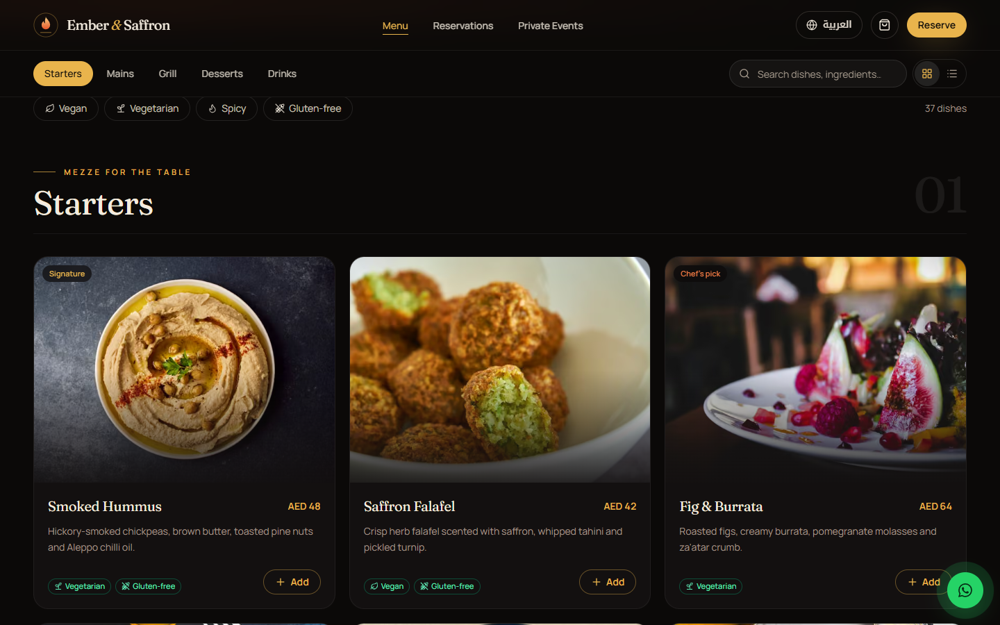

# Ember & Saffron

A cinematic, bilingual website for a fictional upscale Middle Eastern fusion restaurant in Dubai, with online ordering, table reservations and private event enquiries in English and Arabic.

**Live demo:** [restaurant.ahmadkhajeh.com](https://restaurant.ahmadkhajeh.com)

Demo project by Ahmad Khajeh — [ahmadkhajeh.com](https://ahmadkhajeh.com)


## Highlights

- **English and Arabic** with full right-to-left layout, localized routes (`/en`, `/ar`) and a one-tap language switch
- **Online ordering** with dish options, a slide-over cart that remembers your order, delivery or pickup, scheduled time slots, promo codes and a live order tracker
- **Secure checkout** ready for Stripe, with a polished demo payment flow out of the box
- **Table reservations** with date, time and party size, plus a private events and catering enquiry form
- **Searchable menu** with sticky category tabs and dietary filters (vegan, vegetarian, spicy, gluten-free)
- **Cinematic design**: slow-zoom hero, parallax, scroll reveals, hover image previews, a gallery lightbox and smooth page transitions, all respecting reduced-motion settings
- **Fast, accessible and search-friendly**: responsive from small phones to large desktops, social share images and rich restaurant data for search engines
- **WhatsApp chat** button for instant guest contact

| Menu | Arabic on mobile |
| --- | --- |
|  |  |

## Tech stack

- [Next.js](https://nextjs.org) (App Router) and TypeScript
- [Tailwind CSS](https://tailwindcss.com) and [shadcn/ui](https://ui.shadcn.com)
- [Framer Motion](https://motion.dev) and [Lenis](https://lenis.darkroom.engineering) smooth scrolling
- [next-intl](https://next-intl.dev) for internationalization
- [Zustand](https://zustand.docs.pmnd.rs) for the cart
- [React Hook Form](https://react-hook-form.com) and [Zod](https://zod.dev) for forms
- [Stripe](https://stripe.com) and [Resend](https://resend.com) integrations

## Run locally

```bash
npm install
npm run dev
```

Then open [http://localhost:3000](http://localhost:3000).
